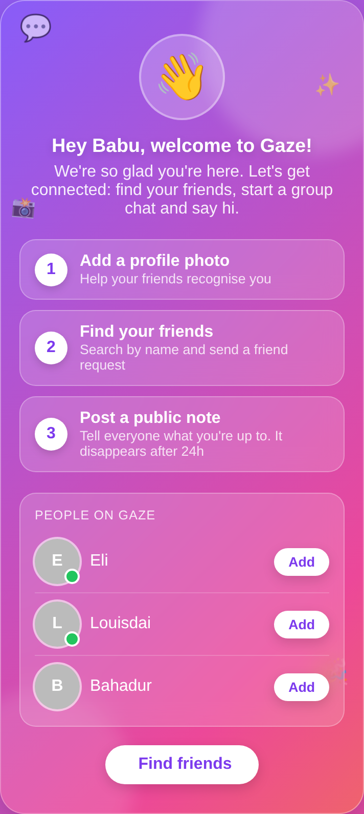
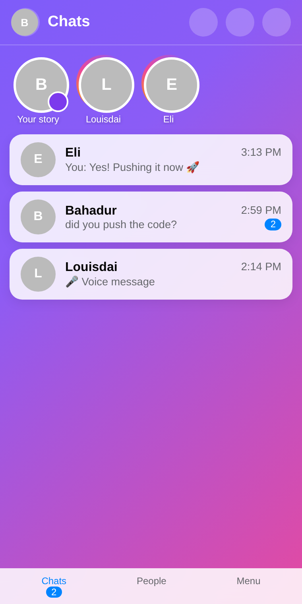
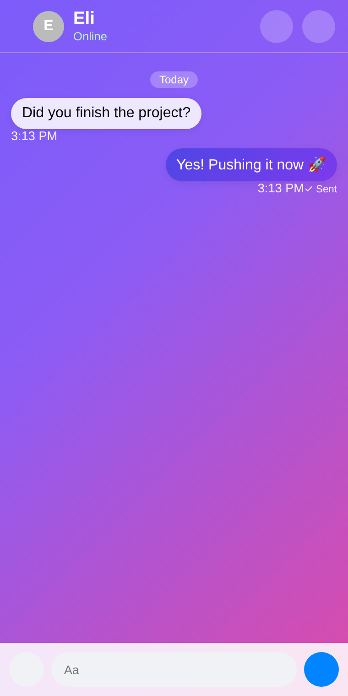
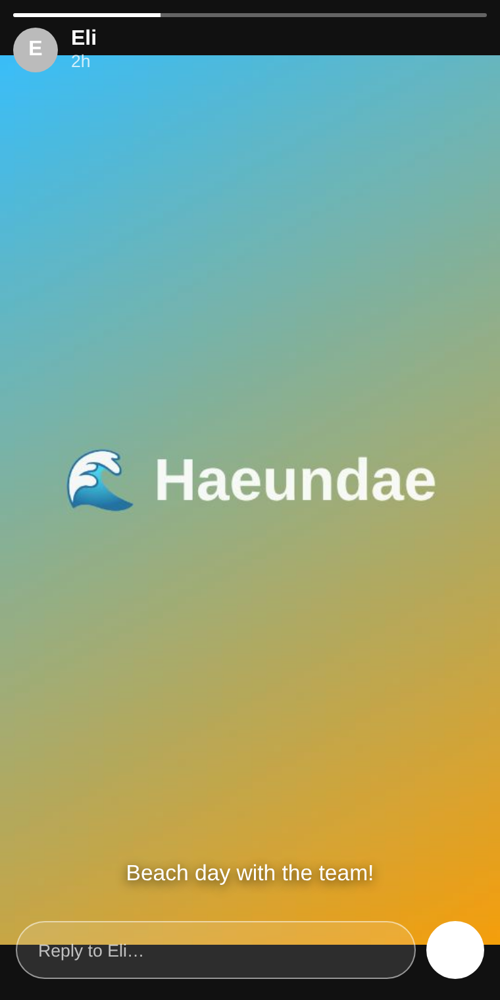
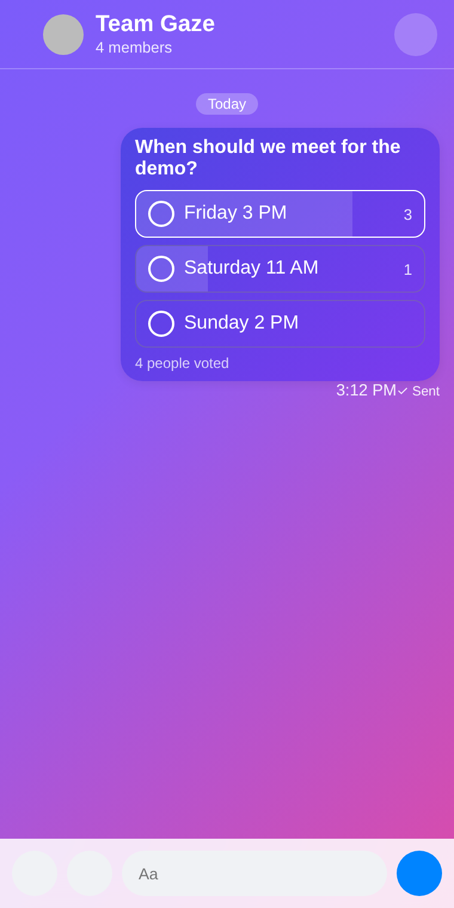
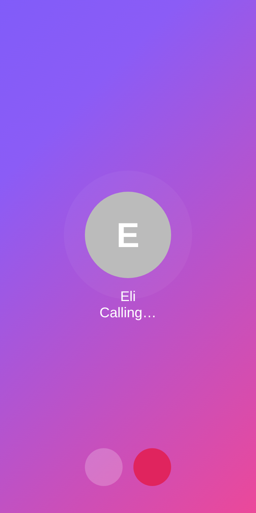
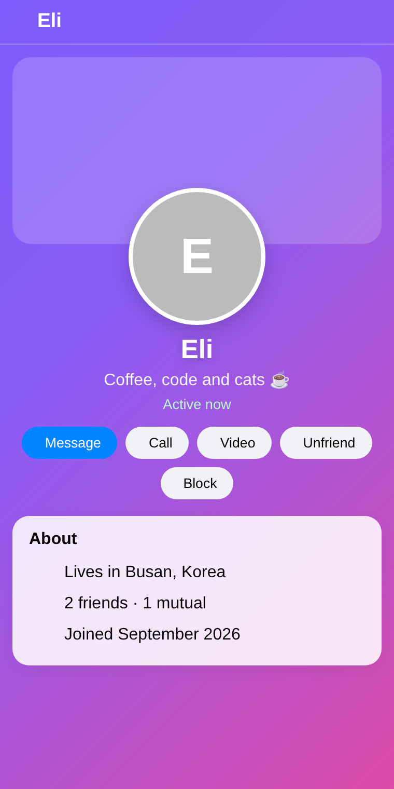
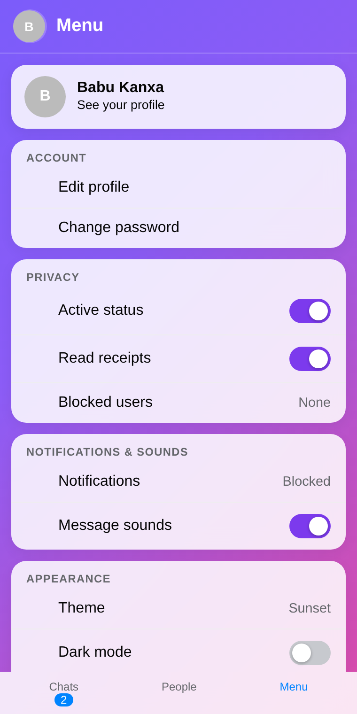
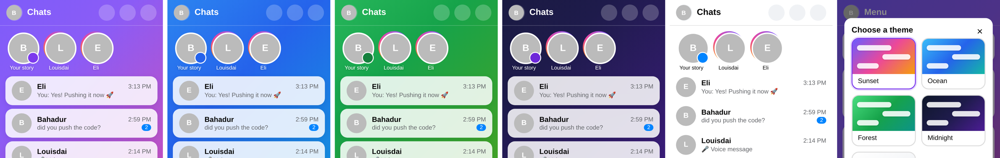

# Gaze 💬 Let's get connected

Gaze is a real-time chat web app, built as our Web Programming team project. It works in the browser on phones and computers. You can chat, call, share stories and run polls with friends, and messages arrive instantly.

**🔗 Live demo:** https://anish123619.github.io/web-programming/team-project/team-project.html

---

## 📸 Screenshots

<table>
  <tr>
    <td align="center"><br><sub>Welcome screen</sub></td>
    <td align="center"><br><sub>Chats + stories</sub></td>
    <td align="center"><br><sub>Chatting</sub></td>
  </tr>
  <tr>
    <td align="center"><br><sub>Stories</sub></td>
    <td align="center"><br><sub>Group polls</sub></td>
    <td align="center"><br><sub>Voice call</sub></td>
  </tr>
  <tr>
    <td align="center"><br><sub>Profiles</sub></td>
    <td align="center"><br><sub>Settings</sub></td>
    <td></td>
  </tr>
</table>

**5 themes:** Sunset, Ocean, Forest, Midnight and Classic



<sub>Preview screenshots taken with test accounts. Icons are not shown in these previews.</sub>

---

## ✨ Features

### Messaging
- One-on-one chats and **group chats**
- **Photos** and **voice messages** (tap the mic, up to 1 minute)
- **Reply** to a message (or swipe right on a phone), **forward**, **edit** and **delete**
- **Reactions** 👍 ❤️ 😂 😮 😢 🙏
- **Typing indicator** and **read receipts** (✓ Sent / ✓ Seen, "Seen by …" in groups)
- **Pin, mute and archive** chats (long-press or right-click a chat)

### Calls
- **Voice calls** and **video calls** in one-on-one chats (WebRTC)
- Mute, camera on/off, switch camera, call timer
- Call log in the chat ("📞 Voice call · 2:31", "📞 Missed video call")

### Stories and polls
- **Stories**: photos that disappear after 24 hours, visible to friends only. Tap through them, reply to a story, see who viewed yours.
- **Polls** in group chats: single or multiple answers, with live vote bars

### People and profiles
- Friend requests (send, cancel, accept, decline)
- **Profile pages**: cover photo, bio, where you live, work and study, birthday, friends and mutual friends
- Unfriend and **block**. Blocked users can't call you, and you aren't notified about their messages.
- **Group admin tools**: rename, group photo, add/remove members, make admins
- **Public notes** that vanish after 24 hours

### Settings and appearance
- **5 themes** plus **dark mode**
- Active status and read receipts on/off, message sounds, text size
- Change password, and **Forgot password** reset by email
- Welcome screen with a getting-started checklist for new users

---

## 🛠 Built with

| Part | Technology |
|---|---|
| Front end | HTML, CSS, JavaScript, Bootstrap 4, Font Awesome |
| Accounts | Firebase Authentication (email + password) |
| Database | Firebase Realtime Database (live updates) |
| Calls | WebRTC, signalling through Firebase, optional TURN relay (Metered) |
| Hosting | GitHub Pages |

---

## 👥 Team

| Member | Role |
|---|---|
| **Neupane Sushant** | CSS styling and user interface design. Focused on making the website visually attractive and user-friendly. |
| **Tamang Anish** | Real-time chat and social features. Responsible for the messaging system and social interactions. |
| **Bohara Vishal** | User authentication and database management. Responsible for user accounts and storing information. |
| **Khadka Satkar** | HTML structure and website layout. Responsible for building the basic structure of the website. |
| **Rawat Iman Singh** | Video calling and system integration. Responsible for video communication and connecting the different parts. |

---

## 📁 Files

```
team-project/
├── team-project.html     # the whole app: HTML + JavaScript
├── style1.css            # base styles
├── Gaze_ logo.webp       # logo
├── database.rules.json   # Firebase security rules
├── README.md             # this file
└── screenshots/          # images used in this README
```

---

## 🚀 Run your own copy

1. **Create a Firebase project** at https://console.firebase.google.com
2. **Authentication** → Sign-in method → turn on **Email/Password**
3. **Realtime Database** → Create database
4. **Rules** tab → paste the contents of `database.rules.json` → **Publish**
5. **Project settings** → Your apps → add a **Web app**, then copy its config into `firebaseConfig` at the top of the script in `team-project.html`
6. **Host it** on GitHub Pages (or any HTTPS host). The microphone and camera only work over **https://**.

### Optional: make calls reliable on every network
Without a TURN server, calls can fail on mobile data and some Wi-Fi networks.
1. Create a free account at https://www.metered.ca/tools/openrelay/
2. Copy your app name and TURN API key from the dashboard
3. In `team-project.html`, set:
   ```js
   const TURN_CREDENTIALS_URL = 'https://YOURAPP.metered.live/api/v1/turn/credentials?apiKey=YOUR_API_KEY';
   ```

---

## 🗂 Database structure (short version)

| Path | What's stored |
|---|---|
| `users/{uid}` | name, photo, cover, bio, details, theme |
| `presence/{uid}` | online / last seen |
| `friends`, `friendRequests`, `sentRequests` | friendships and requests |
| `chats/{chatId}` | messages, reactions, poll votes, typing, seen |
| `userChats/{uid}` | each person's chat list (preview, unread count) |
| `groups/{groupId}` | name, photo, members, admins |
| `stories/{uid}`, `storyViews` | stories and who viewed them |
| `calls`, `incomingCalls` | call signalling |
| `settings/{uid}`, `chatSettings/{uid}` | private settings, pinned/muted/archived chats |

---

## ⚠️ Known limitations
- Photos, voice messages and stories are stored inside the database as text (base64). That keeps setup simple, but chats with many photos load slower. Firebase Storage would be the next step.
- Chats load the latest 100 messages.
- Notifications only appear while Gaze is open in a browser tab.
- Group calls aren't supported (calls are one-on-one).

---

Made for the **Web Programming** course, 2026.
